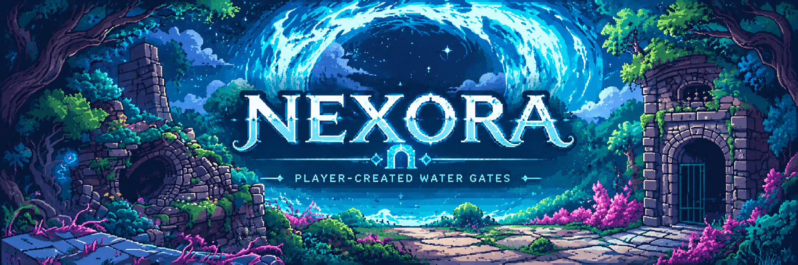

# Nexora

**Build portals. Connect places. Travel instantly.**
A standalone, server-side portal-network plugin for **Minecraft Paper 26.3**, with animated event horizons and a vanilla-compatible fallback.

> [!IMPORTANT]
> DISCLAIMER: This is directly inspired by the CreativeGates plugin from many years ago, however it does NOT use any source code from that project.
> Additionally, this project was started before I became aware of the more modern CreativeGates3 plugin. Nexora is not intended to infringe upon anyone's intellectual property, and is not intended to be used commercially.
> For concerns, please contact me at **iruixos (at) pm (dot) me**

---

## Overview

Nexora allows players to build and connect portals directly in their Minecraft worlds. Construct an enclosed vertical frame, incorporate the configured activation blocks, and activate it with a **renamed clock**. Gates sharing a name form a persistent network, allowing players to travel between locations and, when enabled, between worlds.

Networks support independent routing modes, ownership-based management, persistent SQLite storage, and configurable particle and sound effects. In 1.3.0, portals can use animated event horizons with an optional resource pack, while players without the pack see a legacy water-style fallback.

## Features

- **Build portals in-world:** Activate enclosed vertical frames with a named clock; no creation command required.
- **Configurable frame materials:** Use emerald blocks by default, or configure another solid activation block and minimum count.
- **Named networks:** Matching clock names connect gates; network matching is case-insensitive and Unicode-normalized.
- **Per-network routing:** Choose `PAIR`, `ROUND_ROBIN`, or `RANDOM` independently for each network.
- **Player-controlled management:** Owners can change their networks' routing without operator access.
- **Persistent storage:** SQLite records gate UUIDs, ownership, frame data, and network routing settings.
- **Cross-world travel:** Allow or disallow travel between worlds.
- **Safer arrivals:** Destination exit checks and teleport cooldowns.
- **Configurable effects:** Ambient particles, activation/deactivation effects, teleport particles, and sounds.
- **Interactive help:** Paginated `/nexora help` with clickable navigation arrows and page links.
- **Permission support:** Works with Paper permissions and permission managers such as LuckPerms.
- **Animated event horizons:** Eight selectable portal textures, with `CRYSTAL_SPRING` as the default for new installations.
- **Optional resource pack:** Nexora bundles an optimized resource pack and can offer it when players join.
- **Flexible pack delivery:** Built-in HTTP hosting or a configured public HTTP/HTTPS download URL, including reverse proxies such as Caddy.
- **Legacy visual fallback:** Players who decline or cannot load the pack can see the classic water-style appearance without changing server-side portal blocks.
- **Configuration migration:** Adds missing settings on upgrade, with a backup of the existing configuration.
- **Standalone deployment:** No client-side mods or additional server plugins required.

## Requirements

| Component | Requirement |
|---|---|
| Minecraft server | Paper 26.3 |
| Java runtime | Java 25 |
| Build system | Maven 3.9+ (for source builds) |
| Client modifications | None; optional resource pack for animated visuals |
| Other server plugins | None required |

## Installation

1. Obtain a compiled Nexora JAR, or [build it from source](#building-from-source).
2. Stop your Paper server.
3. Place the JAR in the server's `plugins/` folder.
4. Start the server. Nexora creates its configuration files and SQLite database in `plugins/Nexora/`.
5. Review `config.yml` and `effects.yml`. If using animated portals, confirm the resource-pack download URL is reachable by players.
6. Restart after changing the animated texture or switching portal rendering modes. Use `/nexora reload` for other supported configuration changes.

> [!IMPORTANT]
> When upgrading, back up the entire `plugins/Nexora/` directory—especially `gates.db`—before replacing the JAR. Existing gate and network data should be retained when upgrading between compatible releases. Nexora migrates missing configuration settings and backs up the previous `config.yml`; existing installations retain `WATER` rendering unless explicitly changed.

## Getting started

### Create your first portal

1. Build a **fully enclosed vertical frame** with space inside for the portal.
2. Include at least **two emerald blocks** in its boundary (or the activation block and minimum count configured by your server).
3. Rename a **clock** in an anvil—for example, `vette test`.
4. Hold the named clock and **right-click a frame block from its interior-facing side**, targeting the empty portal interior.
5. Nexora registers the gate. In `EVENT_HORIZON` mode, its interior remains air and the animated surface is rendered visually; `WATER` mode uses the original water-filled interior.
6. Build another frame and activate it with a clock bearing the **same name**.
7. Walk into either gate to travel to the other, provided the destination has a valid exit.

The clock is **not consumed**. Ensure that the destination gate has a clear, dry, two-block-high standing space with a solid floor adjacent to its portal.

### How network names work

Gates activated with clocks named `vette test`, `VETTE TEST`, or `Vette Test` belong to the same network. Matching ignores case after trimming and Unicode normalization; the original network display name is retained.

The creator of the first gate owns the network. With network join authorization enabled, only the owner or an administrator may add gates to that network.

## Portal appearance and resource packs

Nexora 1.3.0 supports two server-side rendering modes:

| Mode | Appearance | Notes |
|---|---|---|
| `EVENT_HORIZON` | Animated portal surface | Default for new installations; uses the optional Nexora resource pack. |
| `WATER` | Classic water-filled portal | Retained for existing installations upgrading from 1.2.3 or earlier. |

With `EVENT_HORIZON`, players who successfully load the resource pack see the configured animation. Players who decline it, encounter a download failure, or have not finished loading it see the **legacy water-style fallback** when `resource-pack.fallback.mode: LEGACY` is enabled. The fallback is client-specific; the server keeps the portal interior as air.

### Animated texture choices

| Texture | Appearance |
|---|---|
| `CLASSIC` | Classic blue water-inspired effect |
| `AQUA_FLOW` | Turquoise flowing currents |
| `DEEP_ABYSS` | Dark blue with luminous streaks |
| `CELESTIAL_VORTEX` | Swirling blue-purple energy |
| `CRYSTAL_SPRING` | Pale aqua ripples and caustics (default) |
| `AZURE_SKY` | Light blue with soft white/silver currents |
| `PEARL_LAGOON` | Seafoam green pearlescent shimmer |
| `BUBBLING_POOL` | Clear-blue surface with rising bubbles |

Set `portal.texture` in `config.yml` and restart Paper to apply a texture change.

### Resource-pack delivery

The bundled `Nexora-Resources.zip` contains the animated textures and artwork. Minecraft downloads it through an HTTP or HTTPS URL when Nexora sends the optional resource-pack request. The player can accept or decline according to their Minecraft multiplayer server resource-pack preference.

- **`MANUAL` (default):** Sends the exact `resource-pack.hosting.public-url` to the client. The bundled default is `https://resources.iruixos.com/Nexora-Resources.zip`; server administrators should replace this with their own reachable URL unless using that host.
- **`AUTO`:** Constructs an HTTP URL from the hostname used to join the Minecraft server and Nexora's configured hosting port. It requires the HTTP port to be externally reachable and is not ideal for reverse-proxy deployments.
- **`hosting.enabled: true`:** Starts Nexora's integrated HTTP server. Keep it enabled when a reverse proxy retrieves the ZIP from Nexora.
- **`hosting.enabled: false`:** Disables integrated hosting. Use this when a separate web server hosts the ZIP directly; update that file when the resource pack changes.

For a Caddy reverse proxy, point the public HTTPS URL to a Caddy site that proxies `/Nexora-Resources.zip` to Nexora's internal HTTP listener (default port `25778`). Minecraft connects to Caddy over HTTPS; Caddy connects to Nexora over HTTP on the internal network.

Example:

```caddyfile
resources.example.com {
    @nexora path /Nexora-Resources.zip
    reverse_proxy @nexora 192.168.50.5:25778
}
```

The example hostname and internal address must be adapted to your deployment. The default `resources.iruixos.com` URL is specific to the project's infrastructure, not a general hosting service for other servers.

### Example 1.3.0 configuration

```yaml
config-schema-version: 2

portal:
  render-mode: EVENT_HORIZON
  texture: CRYSTAL_SPRING
  max-interior-blocks: 225
  allow-horizontal: false
  restore-interior-on-removal: true

resource-pack:
  enabled: true
  hosting:
    enabled: true
    bind-address: "0.0.0.0"
    port: 25778
    url-mode: MANUAL
    public-url: "https://resources.iruixos.com/Nexora-Resources.zip"
  delivery:
    send-on-join: true
    required: false
    prompt: "Download Nexora's animated portal textures?"
  fallback:
    mode: LEGACY
    timeout-seconds: 20
    view-distance: 48
```

If Minecraft does not ask whether to download the pack, check **Multiplayer → Edit Server → Server Resource Packs** and set it to **Prompt**. Minecraft can remember an earlier acceptance or rejection.

## Network routing

Each network has its **own routing mode**, stored persistently. Changing one network does not affect any other network.

| Mode | Behavior |
|---|---|
| `PAIR` | Default. A network may contain up to two gates, which connect to each other. |
| `ROUND_ROBIN` | Fixed directional cycle through the network's gates in stable UUID order; the order persists across restarts. |
| `RANDOM` | Selects a random eligible destination, excluding the gate being entered. |

### Example: expand a paired network

Suppose you've already created two gates using clocks named `vette test` and want to add a third.

1. Stand within eight blocks and look at either existing gate.
2. Run `/nexora network routing round_robin`.
3. Build and activate a third gate with the clock name `vette test`.
4. All three gates now participate in the network's fixed directional cycle.

To use random routing instead:

```text
/nexora network routing random
```

To return to two-gate pairing, first remove the extra gate and then run:

```text
/nexora network routing pair
```

You can also specify the network by name, including names with spaces:

```text
/nexora network routing round_robin vette test
```

> [!NOTE]
> `PAIR` cannot be enabled while more than two gates remain in a network. The `networks.default-routing` setting only affects **newly created networks**; it does not overwrite existing networks' routing settings.

## Commands

### Player commands

| Command | Description |
|---|---|
| `/nexora` or `/nexora help` | Open the paginated help menu. |
| `/nexora help <page>` | Open a specific help page; arrows and page numbers are clickable in chat. |
| `/nexora info` | Look at a gate within eight blocks to see its ID and owner. |
| `/nexora remove` | Look at a gate to remove it safely, subject to ownership and permissions. |
| `/nexora network info` | Inspect the network of the gate you're looking at. |
| `/nexora network info <name>` | Inspect a network by name. Names with spaces are supported. |
| `/nexora network list` | List networks you own. |
| `/nexora network routing <mode>` | Change routing for the targeted gate's network, if you own it. |
| `/nexora network routing <mode> <name>` | Change routing for a named network, if you own it. |

Accepted routing modes: `pair`, `round_robin`, `random`.

### Administrator commands

| Command | Description |
|---|---|
| `/nexora list` | List all registered gates and abbreviated UUIDs. |
| `/nexora remove <short-id>` | Remove a gate by a unique UUID prefix. |
| `/nexora remove <uuid>` | Remove a gate by its full UUID. |
| `/nexora routing <network> <mode>` | Legacy administrative routing command; uses a single-token network argument. |
| `/nexora network routing <mode> <name>` | Set routing by network name, including names with spaces. |
| `/nexora reload` | Reload `config.yml` and `effects.yml`. |

The console can use commands that accept an explicit network name or gate ID. Commands that require looking at a gate are player-only.

## Permissions

| Permission | Default | Purpose |
|---|---|---|
| `nexora.use` | `true` | Enter portals and teleport. |
| `nexora.create` | `true` | Create gates using named clocks. |
| `nexora.destroy.own` | `true` | Remove gates you created with `/nexora remove`. |
| `nexora.network.info` | `true` | Inspect network information and list your networks. |
| `nexora.network.manage` | `true` | Change routing for networks you own. |
| `nexora.admin` | `op` | Administrative commands and ownership bypass. |
| `nexora.reload` | `op` | Reload plugin configuration and effects. |

Default player permissions generally require no additional LuckPerms grants. To explicitly assign network management to a group, for example:

```text
/lp group default permission set nexora.network.manage true
```

Network ownership restrictions still apply: `nexora.network.manage` does **not** permit editing someone else's network.

## Configuration

Nexora generates `plugins/Nexora/config.yml`. The following excerpt shows core gameplay settings; see the [portal and resource-pack settings](#example-130-configuration) above for 1.3.0 rendering and delivery options:

```yaml
activation:
  item: CLOCK
  activation-block: EMERALD_BLOCK
  minimum-activation-blocks: 2
  max-name-length: 32

portal:
  max-interior-blocks: 225
  allow-horizontal: false
  restore-interior-on-removal: true

networks:
  default-routing: PAIR
  require-authorization-to-join: true

teleportation:
  cooldown-seconds: 3
  allow-cross-world: true
```

| Setting | Description |
|---|---|
| `activation.activation-block` | Solid frame material required for activation; e.g., `GOLD_BLOCK`. |
| `activation.minimum-activation-blocks` | Minimum number of activation blocks in the frame. |
| `activation.max-name-length` | Maximum length of a gate's clock name. |
| `portal.max-interior-blocks` | Maximum detected portal interior size. |
| `portal.restore-interior-on-removal` | Restore recorded interior blocks when removing a gate, where applicable. |
| `networks.default-routing` | Routing mode for **new** networks. |
| `networks.require-authorization-to-join` | Restrict adding gates to network owners and admins. |
| `teleportation.cooldown-seconds` | Cooldown after teleportation. |
| `teleportation.allow-cross-world` | Allow destinations in different worlds. |

`activation.item` is currently informational: activation is implemented specifically for named `CLOCK` items. `portal.allow-horizontal` is reserved; horizontal gates are not currently implemented.

Changing the activation block affects newly activated frames after a reload; existing portals remain registered.

### Particle and sound effects

The separate `plugins/Nexora/effects.yml` controls:

- Ambient particles around active gates, including particle type, interval, count, and player range.
- Activation and deactivation particle bursts and sounds.
- Teleport departure and arrival particles, plus teleport sounds.

Example settings:

```yaml
ambient:
  enabled: true
  particle: ENCHANT
  interval-ticks: 20
  particles-per-cycle: 4
  player-range: 24

activation:
  particles:
    enabled: true
    particle: END_ROD
    count: 35
  sound:
    enabled: true
    type: BLOCK_BEACON_ACTIVATE
    volume: 0.7
    pitch: 1.2

deactivation:
  particles:
    enabled: true
    particle: SMOKE
    count: 20
  sound:
    enabled: true
    type: BLOCK_BEACON_DEACTIVATE
    volume: 0.6
    pitch: 1.0

teleport:
  departure:
    enabled: true
    particle: PORTAL
    count: 30
  arrival:
    enabled: true
    particle: END_ROD
    count: 20
  sound:
    enabled: true
    type: ENTITY_ENDERMAN_TELEPORT
    volume: 0.6
    pitch: 1.2
```

Use `/nexora reload` to apply changes. Ambient particles are skipped for unloaded chunks and when no player is nearby, avoiding unnecessary decorative chunk loading.

## Building from source

Install **JDK 25** and **Maven 3.9+**, then from the directory containing `pom.xml` run:

```bash
mvn clean package
```

The compiled, shaded plugin JAR is produced at:

```text
target/nexora-<version>.jar
```

The build includes SQLite JDBC in the plugin JAR. Paper API is a provided dependency and is not bundled.

## Data storage and backups

Nexora stores portal and network information in `plugins/Nexora/gates.db`. Keep this file when upgrading or migrating your server. Back up the database while the server is stopped, or use a SQLite-aware backup procedure, to avoid inconsistent copies.

Removing a gate through Nexora unregisters it and can restore its previously recorded interior blocks. Removing the final gate from a network also removes that empty network's record.

## Known limitations

- Only vertical gates are supported; horizontal gates are not implemented.
- Destination portals require a suitable arrival area.
- Network membership management is owner/admin-based; there is no player-managed invitation list.
- Round-robin routing follows UUID order, not gate creation order.
- SQLite access is synchronous, and database/world-block changes are not crash-atomic.
- Protection against every possible external block-editing mechanism or third-party plugin interaction is not guaranteed.
- Simultaneous multiplayer rendering with one player accepting and another declining the pack has not yet been validated in the reported tests.
- Client-side legacy fallback visuals may require further compatibility testing with other plugins and client configurations.
- Automated regression test coverage is not yet comprehensive.

## Upgrading from 1.2.3 or earlier

Back up `plugins/Nexora/`, including `gates.db`, as well as your world data before upgrading. Nexora 1.3.0 adds missing configuration settings and creates a timestamped backup of the previous `config.yml`. Existing values are preserved, although YAML comments and formatting may change during migration.

Older installations retain `portal.render-mode: WATER` by default. To opt into animated event horizons, set `portal.render-mode: EVENT_HORIZON`, choose a texture, and verify resource-pack hosting before restarting. Switching rendering modes changes how portal interiors are represented; test this on a backup before applying it to a live world.

Existing explicit resource-pack URLs and URL modes are preserved during migration. To use an HTTPS reverse proxy, set `resource-pack.hosting.url-mode: MANUAL` and supply the externally reachable HTTPS URL.

## Project information

- **Plugin:** Nexora
- **Author:** iruixos
- **Platform:** Paper
- **Package:** `com.iruixos.nexora`
- **Notes:** This project contains AI-generated code, but was tested by a human in a real PaperMC server :)

## License

Nexora is licensed under the MIT License.
See the [LICENSE](LICENSE) file for details.
